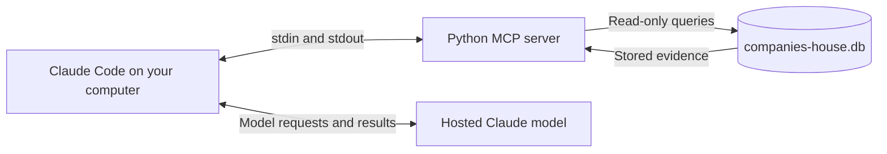

# Use the database with Claude Code

This is a local, read-only stdio MCP server. Claude Code starts the Python
process and exchanges structured messages over its input/output pipes. The
server queries the supplied SQLite file; it does not crawl websites, call
providers, initialise the database, or import local research reports.
Claude's model runs remotely, so returned tool results enter the model context.



## First-time setup

Install Git, Python and Claude Code, then clone the repository. Python 3.13
is the tested version. Access to Claude is needed; enrichment API keys,
Docker, Langfuse, browser downloads and requirements-eval.txt are not needed
to query existing data.

Place the supplied `companies-house.db` in the repository root. Use a consistent
snapshot made by `scripts/backup_databases.py --dest handover`, not a copy of
an actively written database without its WAL transactions. The database is
gitignored and must be delivered separately.

From the repository directory, on Windows PowerShell:

```powershell
python -m venv .venv
.\.venv\Scripts\python.exe -m pip install -r requirements.txt
python scripts/run_companies_house_mcp.py --check
$env:COMPANIES_HOUSE_PYTHON = (Resolve-Path .\.venv\Scripts\python.exe).Path
claude
```

On macOS/Linux:

```bash
python3 -m venv .venv
.venv/bin/python -m pip install -r requirements.txt
python3 scripts/run_companies_house_mcp.py --check
COMPANIES_HOUSE_PYTHON="$PWD/.venv/bin/python" claude
```

The committed `.mcp.json` registers `companies-house-leads` at project scope.
Accept Claude Code's project/server approval when prompted, then check `/mcp`.
If Claude is already running, restart it from this repository to load the
configuration and skills. Claude launches the server; you do not need to run
the server separately in another terminal.

The launcher uses `.venv`, then `.venv-claude` (the existing development
environment), then its current Python interpreter. It finds the repository
and default database from its own file location, independent of the working
directory. `COMPANIES_HOUSE_PYTHON` overrides the command used by Claude;
`COMPANIES_HOUSE_DB` overrides the database path. Relative database overrides
are resolved against the repository root. These variables must be in the
environment when you start Claude. No personal paths or credentials are
stored in the shared configuration.

Use the full environment Python path as above to avoid Windows Store aliases
or a different interpreter on Claude's PATH. Set the variable again in a new
terminal, or use local registration below to save the executable path once.

For this computer only, an alternative that avoids project-scope approval is
local registration. Run it from the repository directory with your installed
Python executable and an absolute launcher path:

```powershell
claude mcp add --scope local --transport stdio companies-house-leads -- (Resolve-Path .\.venv\Scripts\python.exe).Path (Resolve-Path .\scripts\run_companies_house_mcp.py).Path
claude mcp get companies-house-leads
```

Local registration overrides the project entry of the same name and is not
shared through Git. Remove it with `claude mcp remove --scope local
companies-house-leads` when you want to use the shared entry instead.

## Try it

Ask Claude:

> Use the companies-house-leads MCP server to show data coverage, then find
> five B2B businesses with a chosen website and turnover above GBP 1 million.
> Explain the strongest candidate using its financial history, website
> identity, profile quotes and detected technology. Distinguish missing
> advertising research from evidence that it is not advertising.

The following tools add website evidence to the original company, financial
and narrative queries:

| Tool | Result |
|---|---|
| `search_web_leads` | Chosen websites, filtered by company/trading name, description/category, customer type, geography served, town/postcode, technology, Google Ads tag presence and latest-year turnover. |
| `get_company_web_evidence` | Identity checks, Maps listing, business profile and validated quotes, crawl summary, detected technologies with source URLs, saved market assessment and findings. |
| `get_website_pages` | Page URLs, titles, descriptions, conversion metadata and errors from the selected site's latest stored crawl; no HTML cache is required. |
| `get_website_page_text` | Visible text of one crawled page, read from the stored snapshot under `data/raw/website-page-snapshots/` (beside the database; not in git). Takes a URL from `get_website_pages`; pages with `offset`/`max_chars` (up to 20000 characters a call). Never fetches live, and reports `available: false` where the snapshot is not on this machine. |
| `get_company_market_evidence` | Saved advertising assessment, keyword demand/CPC and gap/strength findings. |
| `get_company_financial_history` | One canonical record per financial year, including currency, source document and comparative-overlap status. |
| `get_lead_pipeline_summary` | Existing ingestion counts plus website, profile, market and findings coverage. |

List results default to 20 and are capped at 100; the shortlist and page tools
support `offset` pagination. Evidence strings may be truncated. Profiles and
market results are matched to the current selected domain, technologies to
the selected summary's rule version, and pages to its crawl version. A Maps
listing is the company's latest saved listing; inspect its domain and match
field separately when assessing identity. Timestamps and versions describe
saved observations, not the current live website. Findings have their own
version and evidence and can predate a newer market assessment.

Unknown measurements remain null. A missing market assessment means unknown,
not no advertising. Ad tags establish detected setup, not active campaigns;
a tool not detected may still exist. Annual accounts may lag current trading.
Review currency and financial year before comparing values.

`customer_type` accepts `business`/`b2b`, `consumer`/`b2c`, `mixed` or `unclear`.
`geography` is the service area scale, while `location` matches a town or postcode.

## Skills and Google Sheets

The repository includes `/find-leads`, `/company-brief` and `/export-shortlist`
in `.claude/skills/`. They guide use of the MCP evidence and preserve source
links, dates and uncertainty. Notes, outreach status and sales outcomes belong
in Google Sheets for this handover. No MCP tool writes to SQLite.

A Google Sheets/Drive connection is separate from this MCP server. Without
one, Claude can prepare a CSV/TSV for import; it cannot claim to have published
a native Sheet. Grant access to the intended Sheet/folder separately when
publishing is wanted. The existing project rule places shared deliverable
Sheets in `Projects / companies-house-leads` when that folder is accessible.

## Missing data and troubleshooting

- A missing database fails with a clear message and is never created silently.
- A database with an outdated schema should be replaced by a matching snapshot;
  the query server does not run migrations.
- If dependencies are missing, install requirements.txt using the environment's
  Python as shown above. Do not install all enrichment/evaluation dependencies.
- Use `--check` for a human-readable coverage report. Normal stdio mode reserves
  stdout for MCP messages; errors and diagnostics go to stderr.
- Some pilot research is only in gitignored `logs/`, including
  `logs/web/research-report.json` and `logs/web/w3-phrase-volume.json`. Neither
  `.mcp.json` nor these tools imports those files. Empty market/findings tables
  therefore legitimately return missing evidence. Importing saved research is
  a separate data-change task, not a reason to make new provider calls.

SQLite is opened with `mode=ro` and `query_only=on`; query connections close
after each call. This protects these tools' access. Claude Code's separate
shell/file capabilities are governed by its own permissions and are not
restricted by the MCP connection.
