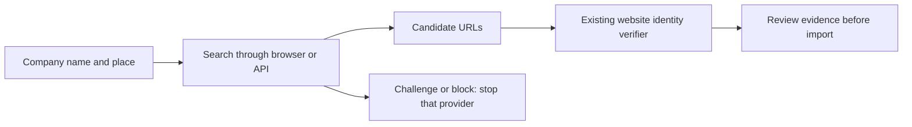

# Browser search feasibility (2026-10-12)

This note records a small, user-authorised Playwright experiment and current
API options. It does not introduce a search provider, run the 425-company
queue, spend API credits, or change SQLite. The experiments used the installed
Playwright Chromium headless browser, the project's explicit research user
agent, an English GB locale, and a fresh browser context. No stealth, proxy
rotation, or CAPTCHA solving was used.

## Captures and observations

Local, gitignored artifacts are under
`logs/web/playwright-search-experiments-2026-10-12/`: `results.json` contains
visible text, links and browser settings; the PNGs capture each page. Google's
consent page and subsequent blocked search are separate records of the same
query, not two successful searches. The experiment stopped Google requests
after its first CAPTCHA.

| Company-name query | Google | Bing | Brave Search |
| --- | --- | --- | --- |
| Tranmere Rovers Football Club Birkenhead official website | Consent, then unusual-traffic reCAPTCHA; no results | Expected `tranmererovers.co.uk` candidate | Expected `tranmererovers.co.uk` candidate |
| Active Hospitality Limited official website | Not attempted after block | Unrelated results about "active" | Expected `active-hospitality.com` candidate |
| Crewe Alexandra Football Club official website | Not attempted after block | Expected `crewealex.net` candidate | Expected `crewealex.net` candidate |

All six Bing/Brave requests returned HTTP 200 and visible search results with
no detected challenge. Bing result URLs were decoded from their redirect
links without visiting the destinations. Brave returned direct destination
links. These are candidate discoveries, not new legal-identity verifications.
The sample is deliberately small and selected; it cannot establish accuracy,
long-run availability or suitability for a production batch. An earlier plain
HTTP DuckDuckGo HTML test returned a duck-selection challenge, not results;
that was not a Playwright experiment.

The existing `web_manual_lookup.py` still needs supplied candidate URLs. The
experiment demonstrates a possible discovery step ahead of that verifier;
it has not connected the two or imported any records.

Playwright also supports Firefox, WebKit, Chrome and Edge. Only Chromium was
tested here. Changing browsers does not establish that Google's block will
disappear. See the [official browser documentation](https://playwright.dev/python/docs/browsers).

## API options and the configured Brave adapter

Prices below are USD, checked against the providers' pages on 2026-10-12.
Allowances are account-specific and shared with any other usage. Search fees
exclude tax, optional content extraction and model inference.

| Provider / mode | Base search fee per 1,000 requests | Published free allowance |
| --- | --- | --- |
| Brave Search, including LLM Context | $5 | $5 monthly credit, equivalent to 1,000 searches; payment card required |
| Exa Instant | $4, up to 10 results | $10 monthly credit plus $10 onboarding bonus; no payment method required |
| Exa Fast / Auto | $7, up to 10 results | Same Exa credit pool |
| Tavily Basic | $8 pay-as-you-go, one credit per search | 1,000 credits monthly; no payment card required |
| Tavily Advanced | $16 pay-as-you-go, two credits per search | Same Tavily credit pool |

Sources: [Brave pricing](https://brave.com/search/api/),
[Exa pricing](https://exa.ai/pricing), [Tavily pricing](https://www.tavily.com/pricing),
and [Tavily credit usage](https://help.tavily.com/articles/6938147944-basic-vs-advanced-search-what-s-the-difference).

Brave's current billing documentation allows a $0 prepaid balance at signup
to access the monthly free credit, with a payment-card authorisation check.
Its automatic reload amount has a $5 minimum, rather than requiring the
DataForSEO $50 top-up. New Brave plans are prepaid; existing postpaid plans
can remain postpaid. See [Brave billing details](https://api-dashboard.search.brave.com/documentation/resources/help-feedback).

At $5 per 1,000 searches, Brave usage of 1,000 / 5,000 / 10,000 requests in a
month consumes $5 / $25 / $50 of credit: after the $5 monthly allowance, the
chargeable usage is $0 / $20 / $45. For the 425-company queue, a hypothetical
two to four searches each means 850 to 1,700 requests, or $4.25 to $8.50 gross;
with unused monthly credit, that is $0 to $3.50 chargeable usage. These are
volume estimates, not measured resolution rates or an authorised batch.

## Relevance to private chat

Read-only inspection of the sibling `private-llm-chat` README, Markdown
documentation, backend source and project brief found no Brave or web-search
integration. Its README describes local Ollama, a private AWS GPU, and hosted
OpenRouter modes.

[Brave LLM Context](https://api-dashboard.search.brave.com/documentation/services/llm-context)
returns query-relevant page chunks and source URLs for the caller's own model
to consume. Brave Answers is a separate hosted answering service, priced at
$4 per 1,000 requests plus $5 per million input/output tokens. LLM Context
would therefore be the relevant endpoint when retaining the existing chat
model as the answer generator. Search-only use does not require Brave to
generate the answer.

A future design could issue a short search phrase only when a conversation
needs current information, then pass bounded source text to the selected
model. The search provider receives that phrase; local/private inference
does not keep the search request on the local machine. Local Ollama has no
additional cloud token fee; hosted models charge separately for the added
context. Brave's published terms require explicit storage rights to retain
API results, so storing raw snippets or search responses in durable chat
history or this project's cache needs that issue resolved before integration.
See [Brave's storage FAQ](https://brave.com/search/api/#faq).

The Companies House project now contains a Brave Web Search adapter and a
candidate-discovery API mode. It reads `BRAVE_SEARCH_API_KEY` from the ignored
`.env`, caches raw responses and saves candidate URLs for verification. No API
account, key, API call or private-chat code was added or changed at the time of
this experiment.
