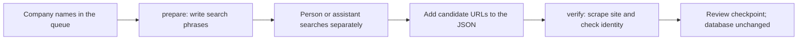

# Web stage (stage 2 of the lead funnel)

The search screen (`docs/SEARCH_SCREEN.md`) keeps companies whose customers
could plausibly find them online: 1,573 of the 2,268 target companies pass
(`company_search_screen`, prompt `search-screen-v3-balanced-evidence`). A
filing says what a business is, but rarely how its customers find it, and
only 2% of the 2,273 cached filings mention a web domain at all. This stage
uses the web to answer what the filing cannot:

- **Fit:** do people search for what the company sells, and can its site
  take a sale, booking or enquiry?
- **Gap:** is it not advertising, advertising badly, or outbid by
  competitors?
- **Classification:** Google's own business category in place of the SIC
  code, plus facets for how the business sells.

Ability to pay comes from the filed financials, which are already in SQLite.

This document was written before any labelling or search call, so the
definitions and acceptance criteria below are a pre-registration: change
them only by adding a dated note, never silently.

## Steps

The current build order, provider choices and costs are in
`docs/WEB_STAGE_PLAN.md` (redrafted 2026-10-02 after the DataForSEO test).

| Step | What | Cost | Code |
|---|---|---|---|
| W0 | Queue order, provider adapters, this document | free | `scripts/website_analysis/web_rank_order.py`, `scripts/website_analysis/search_providers.py` |
| W1 | Website and Google Maps listing per company | Serper free credits | `scripts/website_analysis/web_identity.py`, `scripts/website_analysis/web_population.py identity` |
| W2 | Crawl up to 25 pages per site; detect ad, analytics, CRM, call-tracking, booking and shop tools | free | `scripts/website_analysis/web_crawl.py`, `web_browser.py`, `tech_rules.py`, `web_detect.py` |
| W3 | Site profile: summary, Google category, how-it-sells facets, search phrases | OpenRouter, ~$0.003 a company | `scripts/website_analysis/web_profile_policy.py`, `web_profile_eval.py` |
| W4 | Ads Transparency, keyword volume and cost per click, organic traffic, optional live check | DataForSEO ($1 free credit, or the friend's account) | `scripts/website_analysis/web_market.py` |
| Findings | Talking points, setup level, gap segment | free | `scripts/website_analysis/web_findings.py` |
| W5 | Lead sheet and outcome log | free | `scripts/website_analysis/web_handoff.py` |

## Providers and allowances

Checked 2026-10-01. The user chose not to pay a $50 minimum top-up up front,
so every step starts on a free allowance. A top-up is decided only after the
W1 gold score and the first W4 batch show which source earns its place.

| Provider | Free allowance | Used for |
|---|---|---|
| Serper.dev | 2,500 credits, one-off, no card | Google Maps listings (category, website, rating, review count) and organic results |
| DataForSEO | $1 credit, one-off, no card | Keyword volume and cost per click ($0.09 per live task of up to 1,000 keywords); live results with the paid ads ($0.002 each) |
| SerpApi | 250 searches a month, no card | Google Ads Transparency Center |
| postcodes.io | free, unmetered | Registered postcode to coordinates |

Serper's results do not reliably include paid ads, so ad evidence comes from
DataForSEO and SerpApi only. The fallback if Serper's credits run out is the
Google Places API (New): pay as you go, no minimum, 1,000 free text searches
a month at the tier that returns the website.

Every call is cached under `data/raw/search-api-responses/`, so a re-run costs
nothing. Every billed call is logged in `logs/web/provider-usage.jsonl`, and
a call that would pass the allowance is refused, which stops the step at its
last checkpoint. A run that spends a free allowance needs the user's go, like
a paid run: the allowance is finite.
`python -m scripts.website_analysis.web_population usage` shows what's left, and
`python -m scripts.website_analysis.search_providers check` shows which keys are set and
checks DataForSEO's login and live balance (`appendix/user_data`, free).

Two DataForSEO endpoints are free and never ledgered: the account check, and
`business_listings/categories`, Google's 5,156 business categories (e.g.
`dental_clinic`, `kitchen_remodeler`). W3 classifies companies without a Maps
listing onto that list. `search_providers categories` downloads and caches it.

## Queue order (W0)

The free allowances do not stretch to every company, so companies are looked
up in a fixed order. The order is not the lead ranking, which is a separate
stage scored by precision at k on the friend's outcomes. The rule:

> Core turnover band first (GBP 1m to 50m), then above it, then below it.
> Within a band: profitable before loss-making, growing (turnover up on the
> previous year) before not, then larger turnover first.

Above the band, companies usually market in house or through an agency;
below it, a paid-search budget is small. Both stay in the queue, later.

The 35 passing companies that Gate A flags as duplicates of another entity
(`company_signals.duplicate_of`, e.g. PENNYFARTHING DEVELOPMENTS against
PENNYFARTHING HOMES at £47.8m each) are left out: both entities would
resolve to one website. That leaves 1,538: 1,133 in the core band, 140 above
and 265 below (turnover from `company_financial_history`). The order is
frozen to `logs/web/queue-order.json` so a later history backfill cannot
reshuffle a run part-way.

## W1: identity

### Definitions

A company's **website** is the site where a customer would buy from, book or
contact that company's trade. A group or brand site counts when that is
where the trade is presented. Directory, review, social and company-data
pages never count.

For each company the resolver:

1. Searches Google Maps for the cleaned name at the registered postcode
   (UK-wide if no listing there matches the name). Legal words and
   parentheticals are dropped: `J F ASHTON (NORTHERN) LIMITED` becomes
   `J F Ashton`.
2. If no listing's site is `verified` or `probable`, runs an organic search
   on the cleaned name plus any place the parentheses held (`City Hotels
   Dunfermline`), and tries up to three guessed domains that resolve in DNS.
3. If still nothing is `verified` or `probable`, searches for the company
   number in quotes.
4. Checks each candidate site (at most 8): the homepage plus up to 6
   privacy, terms, legal, contact, about or cookie pages, stopping once the
   company number is found. It honours robots.txt and caches every page.

Tiers, per candidate site:

| Tier | Rule |
|---|---|
| `verified` | The registered number appears: exactly, with spaces or hyphens inside it, or without its leading zeros when next to the words company, registered or number. UK trading-disclosure rules require it on a company's website. |
| `probable` | The cleaned registered name and the registered postcode both appear, or a Maps listing matched on name and postcode links to the site. |
| `ambiguous` | Only the name appears, or the domain spells the name. |
| `none` | Nothing, an unreachable site, or a parked domain. |

The company's answer is its best candidate, or `none`. A `none` is a
recorded result ("no website found"), not missing data.

A Maps listing **matches** when most of its distinctive name tokens are
shared with the registered name, or one cleaned name contains the other.
The match is recorded as `name+postcode`, `name+domain` (its website is the
chosen site) or `name_only`. Its category becomes Google's own business
category for the company in W3.

Stored in `company_web_identity` (each checked candidate, `role` main,
candidate or none) and `company_google_listing` (see
`docs/DATABASE_SCHEMA.md`).

### Manual candidate discovery (2026-10-12)

`scripts/website_analysis/web_manual_lookup.py` provides a path with no Serper,
DataForSEO or model calls. It prepares the companies still awaiting their first
identity lookup, in current queue order. A person or an assistant using ordinary
search then supplies candidate URLs. The existing W1 site checker reads the
supplied sites and their legal/contact pages, recording the same identity
evidence as the provider-backed resolver. This is assisted discovery, not an
automated search-engine scraper, and it does not collect Google Maps listings.

Given only a company name, this helper does **not** discover its website. It
produces search phrases; a separate search session must find a candidate URL
before `verify` can do anything. The 425 pending entries on 2026-10-12 meant
425 companies with no first discovery lookup recorded, not 425 known websites.
The DataForSEO adapter can perform company-name searches automatically, but
small per-search charges still require funded credit; the $50 minimum top-up
is why the user chose not to use that route here.



```powershell
python -m scripts.website_analysis.web_manual_lookup prepare --output logs/web/manual-lookup-queue.json
```

The editable JSON has `candidate_urls: []` per company, plus search phrases.
Fill those lists with full `https://...` URLs; a specific legal page can be used
as the starting URL. The queue is working input, not a report spreadsheet.

```powershell
python -m scripts.website_analysis.web_manual_lookup verify --input logs/web/manual-lookup-queue.json --output logs/web/manual-lookup-checkpoint.jsonl --limit 5 --browser
```

`--limit` is required and bounds companies with supplied URLs. Up to eight
candidate domains are checked per company. `--cache-only` makes no network
requests; `--browser` uses the existing Playwright fallback for thin readable
HTML, never to retry a refusal or challenge. Playwright and its Chromium
browser must be installed for rendering. Website requests honour robots.txt
and the project's cache and host pause.

Both commands leave SQLite unchanged. Each verification result is checkpointed
as it finishes. Review matches before passing accepted `verified`/`probable`
records to the existing `web_population.store_identity` function. Do not import
failed manual checks as `none` identity results: they only say the supplied URLs
were insufficient, not that a full discovery search found no website.

The first five pending queue companies were tried on 2026-10-12. Ordinary
search found candidate sites for all five. After browser rendering of thin
HTML, the existing checker returned one probable match (Tranmere Rovers),
three ambiguous matches (Active Hospitality, Crewe Alexandra, Entertainment
Partners UK), and one blocked site (Royalton). No records were imported into
SQLite. This small, ordered pilot demonstrates the assisted workflow; it is
not a coverage or accuracy estimate for the remaining population.

A separate [browser search experiment](SEARCH_DISCOVERY_EXPERIMENTS.md) on
2026-10-12 tested discovery from company names using Playwright: Google
challenged the first search after consent; Bing and Brave Search returned
readable results for three names each. Brave surfaced the expected candidate
domain for all three and Bing for two. This was a feasibility sample, not a
batch or a new provider integration. Captures remain in gitignored `logs/`.

`web_brave_browser_search.py` is the bounded public-page batch helper built
after that experiment. It searches one company-name phrase at a time in one
identifiable Playwright Chromium context, records candidate URLs and fsyncs a
JSONL checkpoint. It stops at the first Brave consent screen, challenge or
block and has no API key, paid credit or SQLite write. It does not replace W1
verification: run `web_manual_lookup verify` on its reviewed output before any
identity result is stored. The user authorised the first run across all 425
then-pending companies on 2026-10-12:

```powershell
python -m scripts.website_analysis.web_brave_browser_search run --output logs/web/brave-browser-discovery.jsonl --limit 425
```

The authorised run began with a two-second pause and stopped after seven
successful pages when Brave returned HTTP 429 with a proof-of-work CAPTCHA on
company eight. The seven completed records contain candidates; the block record
contains no candidate URL and is eligible to be retried later. The remaining
417 companies were not searched. This is a provider rate limit, not a result
that the companies lack websites.

### Brave API candidate discovery (configured 2026-10-12)

The same helper now has a `--backend api` mode for Brave's supported Web Search
API. It fetches only organic candidate pages; it does not provide Google Maps
listings and does not make an identity decision. Responses are cached in
`data/raw/search-api-responses/brave/`, each uncached request is written to
`logs/web/provider-usage.jsonl`, and a command refuses to start without an
explicit request cap. Add `BRAVE_SEARCH_API_KEY` to the ignored `.env` after
activating the Brave Search **Search** plan, then check configuration:

```powershell
python -m scripts.website_analysis.search_providers check
```

The first real run below has a hard cap of 425 requests. It requires a new
user go because it consumes Brave's monthly credit; review its JSONL candidates
through `web_manual_lookup verify` before storing anything in SQLite.

```powershell
python -m scripts.website_analysis.web_brave_browser_search run --backend api --output logs/web/brave-api-discovery.jsonl --limit 425 --brave-allowance 425
```

`verify` accepts this JSONL directly. It hydrates each record from SQLite with
the registered postcode and known trading names, then checks the candidate site
and its legal/contact pages. It can run independent sites concurrently; every
completed company is fsync-checkpointed, so reruns resume safely.

```powershell
python -m scripts.website_analysis.web_manual_lookup verify --input logs/web/brave-api-discovery.jsonl --output logs/web/brave-api-identity-checkpoint.jsonl --limit 423 --workers 32
```

The 2026-10-12 run checks all 423 discovery records and writes the current
versioned outcomes to the checkpoint. `verified` and `probable` records are
candidate official sites for review; the other tiers remain useful evidence but
are not accepted websites. The checker rejects company directories and
registries even if they display a registered number. This checkpoint is not yet
imported into SQLite.

### Gold set

`evals/website_identity_gold_set/`, separate from the other gold sets.

- **Draw:** 100 companies, a seeded random sample (seed 20261001) of the
  1,538 companies in the queue (screen-passing, duplicates left out),
  recorded in `selection.json`. This is the population the stage runs on,
  so the headline numbers describe it directly.
- **Blind subset:** the first 25 drawn. The reviewer finds each website by
  hand (or writes `none`) before the resolver's answer is visible, so
  reviewer and resolver agreement is measurable rather than anchored.
- **Review:** the other 75, plus the blind 25 once labelled, are reviewed
  with the resolver's answer shown. The reviewer writes `agree`, the correct
  domain, or `none`, and whether the matched Maps listing is the company.
- **Correct** means the resolver's domain and the reviewer's have the same
  registrable domain (`shop.example.co.uk` and `example.co.uk` match).

Tooling: `python -m scripts.website_analysis.web_review draw | export | import-verdicts |
score`. Nothing in it calls a provider.

### Acceptance criteria (recorded 2026-10-01, before any labelling or search call)

1. `verified` precision ≥ 98%.
2. `verified` + `probable` precision ≥ 95%.
3. Coverage ≥ 70%: of the gold companies the reviewer says have a website,
   the share the resolver answers correctly at `verified` or `probable`.

Each is reported with a Wilson 95% interval. With about 60-80 cases per
figure the intervals are wide, so a pass is "point estimate meets the
threshold", with the interval stated next to it. A miss on criterion 1 or 2
blocks the population run until the tier rules change; a miss on 3 alone
means more companies reach W3 without a site and stay as `site_first`
candidates.

Listing precision (the matched listing really is the company) is reported
but has no threshold. It is measured here for the first time.

### Run order

Each run spends Serper credits and needs its own go.

1. `identity --limit 20 --cache-only`: free dry run; stops at the first
   uncached search.
2. `identity --limit 20`: pilot on the top 20 of the queue (gold cases
   excluded), about 50 credits. Check the cached responses against the
   hand-written test fixtures, and the credits Serper actually charges per
   Maps search.
3. Blind labels for the 25, then `identity --gold` (about 250 credits), then
   the review sheet and `score`.
4. If the criteria pass: `identity --limit N` down the queue, as far as the
   remaining credits go (about 1,000-1,300 companies at ~1.6 credits each).

## W4 findings (2026-10-02, 23 user-chosen companies)

`web_population research` on 23 companies the user picked from the screen
results in another session (20 distinct websites, found by hand and checked
by company number; not a random sample, so read the rates as indicative).
Total DataForSEO cost $0.27: $0.104 for the two batch calls, then about
$0.006 a company, plus $0.012 for each advertiser's paid-keyword list. The
results sheet is in the Drive folder ("DataForSEO research - 23 test
companies").

- **Ads Transparency is the advertising signal; Labs' paid estimate is
  not.** Ads Transparency shows 11 of the 20 websites advertising on Google
  in the past 30 days, all by verified advertisers (e.g. Bott & Co, Protect
  Line, Davisons, Store First, Free Soul). The Labs bulk traffic estimate
  found paid traffic for only 3 of those 11 (Store First, Low Wood Bay,
  24/7 Home Rescue), and none for the other 9. So Labs misses most UK small
  and mid-sized advertisers, though it raised no false alarms. W4's gap
  segment therefore uses Ads Transparency (plus the W2 Google Ads tag), and
  Labs is kept for organic traffic.
- **One live results check never caught an advertiser.** None of the 11
  active advertisers appeared in the ads on its single live check, and many
  checks showed no ads at all. A snapshot from one point is good for organic
  position and map-pack presence (e.g. Store First and both nurseries were in
  the map pack), not for ads or for counting competing advertisers.
- **Google's category is a usable replacement for SIC.** 17 of the 20
  websites matched a Maps listing through the listing's own website link,
  with categories such as `Central Heating Service` (24/7 Home Rescue, SIC
  43220), `Vitamin & Supplements Shop` (Free Soul, SIC 47910),
  `Construction equipment supplier` (CID Group, SIC 47990), `Insurance
  broker`, `Self storage facility`, `Nursery school`. Two were misleading
  (`Investment company` for Improveasy, `Cafe` for Green & Fortune's
  venues), so W3 keeps the site's own description beside it. Aran and Rettie
  found no listing: their registered offices are far from where they trade.
- **Cost per click separates markets sharply:** life insurance phrases at
  $46-59 a click, claims $30-62, solicitors $17-21, self storage $17,
  accountants $15, nurseries $4, hotels $1-3. `monthly_click_value_usd` is a
  ceiling (every search bought), useful for ranking markets, not as a spend
  figure.
- **Not advertising, in a market people search:** Price Slater Gawne
  (solicitors), BK Plus (accountants), Clarion Wealth Planning, CID Group,
  Dukes London, Millie's House and Jancett (nurseries), Endurance Vehicle
  Solutions and Green & Fortune. These are the shape of the `greenfield`
  segment.
- **Prices:** Labs bulk traffic for 20 domains cost $0.0144 (the cheap
  published rate is the real one). Keyword volumes cost $0.09 per call of up
  to 1,000 phrases. Maps, Ads Transparency and live results cost $0.002 each.
  A "No Search Results" answer (status 40102, e.g. no ads) is billed like any
  other call and is now cached and ledgered as an empty result.
- **Unverified accounts:** until the account was verified, DataForSEO
  allowed a handful of calls and then refused with "verify your account".

## Status (2026-10-02, later)

All of W0 to W5 is built and unit-tested; nothing paid has been run beyond the
23-company DataForSEO test. What has and has not run on real data:

- **Live, free:** the W2 crawl ran on the 20 test websites (336 pages, plain
  downloads). Detection found HubSpot (Improveasy, Price Slater Gawne), Zoho
  (Scottish Dental Care), Mediahawk (Low Wood Bay), Ruler Analytics (Store
  First), Klaviyo and Shopify (Free Soul). The Google Ads tag agrees with Ads
  Transparency on 19 of 20 sites; Rettie advertises (38 ads) but shows no tag
  on any crawled page. Two false positives were found on real Tag Manager
  containers and fixed: `__lcl` is Tag Manager's link-click trigger, not
  LinkedIn, and `viewthroughconversion` is in Tag Manager's own runtime.
- **Not yet run:** the browser fallback against a real site (Playwright is not
  installed here; BK Plus is recorded as `blocked`), W1 on the gold set (needs a
  Serper key and the 25 blind labels), W3 (a paid OpenRouter run), and the
  stored `company_market`, findings and lead sheet on real data.
- **Decisions still open:** whether the friend's DataForSEO key may be used and
  at what cap; whether `site_first` companies are leads (default: left out);
  any trade or area filter before W4.
