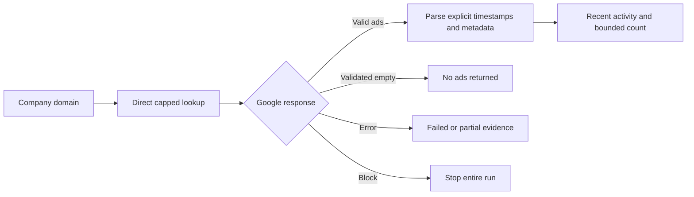

# Direct Ads Transparency scraper: 14 October 2026

The fixed scraper returned usable advertising evidence for all 50 tested
company domains without a proxy. This establishes feasibility for the tested
on-demand workload, not accuracy across the entire company population or
reliability at sustained high volume.

## Changes

Live creative timestamps are read from fields 6/7, with string seconds in
member 1 and nanoseconds in member 2. The old integer scan incorrectly read
nanoseconds as dates in 2000-2001 and reported false negatives for activity.
Verification is read from the creative response, and format from its enum
rather than its thumbnail. Partial pages survive a later failure. Unknown
activity/count/verification is null, and lookups distinguish complete,
partial, failed and blocked. Advertiser fallback requires an identity match.
Robots blocks stop requests, redirects are not followed, and local limits
are distinguished from Google blocks. `--refresh` fetches current evidence
instead of reusing an old cache.

Google omits empty protobuf fields: `{}` was observed for two browser searches
showing zero ads. The parser accepts this with the validated request shape,
including mandatory field 7; unexpected nonempty shapes still fail. Silent
empty responses after a future API change remain a limitation.

## Experiment

The user authorised experiments on about 50 companies. The run used 20
historical pilot sites plus 30 seeded random sites from the chosen website
population. One stored site was only `com.tr`, not a company domain; its
attempt is preserved but excluded and replaced. No database values were
changed. No paid providers, model calls, proxies or free search-provider
allowances were used.

Sequential direct requests were paced at 1.5 seconds, with two seconds between
companies, at most 12 RPC calls per company across retries, a shared cap of
600, and a 120-ad retrieval limit. Any observed block would stop the batch.
Interrupted work resumed from a per-case fsynced checkpoint. Saved bodies
were rescored rather than downloaded again when fixing empty-field handling.

| Latest result for valid domains | Companies |
|---|---:|
| Complete library retrieved | 45 |
| Ads found; stopped at the 120-ad limit | 5 |
| Lookup failed or blocked | 0 |
| At least one ad returned | 24 |
| Ad last shown within 30 days | 23 |
| No ads returned | 26 |

The rows describe overlapping outcomes, not categories to sum. All 1,131
retained creatives had readable last-shown dates. CID Group had an older ad
(last shown 10 September); the other 23 domains with ads had recent evidence.
The historical pilot yielded ads for 14/20 domains; the random group 10/30.
These are prevalence observations, not an accuracy score.

There were 170 HTTP 200 RPC responses and 54 robots HTTP 404 responses,
including development retries and the excluded input. No recorded DNS error,
timeout, HTTP 403/429 or challenge occurred. There are 57 checkpointed case
attempts: the final 50 valid company results, the excluded input, and six
earlier attempts repaired during development. All attempts have Langfuse
traces and dataset items in `ads-transparency-direct-experiment` on the existing
localhost instance. An interrupted trace was backfilled from saved evidence
without making another Google request.

## Browser checks and limits

Anonymous browser checks confirmed zero ads for Clarion Wealth and Dukes Hotel.
Aran's three creative IDs and verified advertiser match the direct response;
its first creative is Text and was last shown on 13 October, matching the fixed
parser. Rettie's fixed result is 41 ads and recent activity, consistent with
the prior browser count; current dates now read 14 October.

The other company outcomes were not independently labelled in the browser.
No claim of 100% classification accuracy is made. Country filtering remains
advisory, domain evidence can include multiple advertisers, and capped counts
are lower bounds. The undocumented Google interface can change. The experiment
provides no evidence that Oxylabs is needed at this workload.

Evidence and the per-company Markdown report are under the gitignored
`data/raw/ads-transparency-experiment-2026-10-14/` directory. This is a Markdown
report, not a spreadsheet deliverable. Validation: 941 tests passed, one
skipped, and one existing Pydantic warning.

